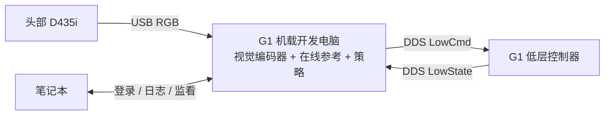

# G1 29 自由度 EDU 与 D435i 真机实验教程

适用设备：你的 29 自由度 G1 EDU、安装在头部的 D435i，以及本目录的 `models/vggt_hierarchical_rgb64`（model_2400）模型。更新日期：2026-10-28。

**部署方向：优先在 G1 机载开发电脑上运行推理和控制，笔记本负责开发、登录、记录与监看。当前真机入口默认关闭额外的关节目标限幅、变化率限制和跟踪误差自动中断；X 键、红色按钮、遥控器 SELECT 可锁存阻尼停止。实机表现仍需从只读、影子和受支撑试验开始验证。**

当前 `hardware/` 与模型已复制到 G1 的 `/home/unitree/vibe_g1`，并建立独立 Python 3.11 环境。默认模式无需旧的受保护仿真报告；加 `--actuator-guards` 可以恢复原动作保护，并重新要求匹配的 `--acceptance-report`。通信超时、非有限数值、电机状态/温度检查和显式接管仍保留。姿态偏差、倾斜和偶发调度迟到不再自动停止；50 ms 状态、60 ms 目标和 150 ms 图像/输入更新检查仍保留。按用户要求增加 `--allow-unmeasured-camera`，可明确跳过相机安装标定，日志仍记为未标定；它与 `--calibration` 互斥。X 是当前 pygame 控制窗口内的快捷键，不是全系统热键；软件阻尼不能代替机器独立急停。

日常只看命令和操作说明，请使用 [`G1_RUN_COMMANDS_ZH.md`](G1_RUN_COMMANDS_ZH.md)。官方遥控器 SELECT 已接入本程序的锁存阻尼停止，现场按键映射和实际停止响应仍待验证。

## 1. ViBe 到底在机器人还是笔记本上推理

ViBe 发布的部署工作区把 tracker、视觉 encoder、planner 和 bridge 放在 `onboard` 配置中；`offboard` 只构建遥测桥接、消息和查看工具，不构建控制、视觉推理和规划的运行程序。它另有 Jetson ARM 的安装支持。因此，按照该工作区的部署分工，应把推理放在机器人端，笔记本作为外部工作站。[ViBe 部署说明](https://github.com/drcl-deploy/vibe_ws/blob/main/docs/setup.md#onboard-and-offboard)

这说明的是发布代码的部署架构。论文正文确认了 G1、头部 D435i、RGB 输入和 50 Hz 策略，但没有明确列出实验所用机载计算机的具体型号。不能据此断言作者所有视频都用了某一款 Orin，也不能仅凭“29 自由度 EDU”确定你的机载算力。[ViBe 论文第 4.1 节](https://arxiv.org/html/2609.09918v1#S4.SS1)

建议你的最终连接方式如下；机载端是否达到实时要求，需要按第 5、8 节实测。



| 位置 | 负责的任务 | 本项目现状 |
|---|---|---|
| 头部 D435i | 彩色图像采集 | 模型使用 RGB，不需要深度图或 D435i 的 IMU |
| G1 机载开发电脑 | 读取相机、生成参考、策略推理、发送关节目标 | 已部署 TensorRT、独立推理进程、V4L2；只读性能结果见第 5 节；电机控制未启动 |
| G1 低层控制器 | 返回关节和机身 IMU 状态，执行电机控制 | 通过 Unitree SDK2 接入 |
| 笔记本 | 编辑、复制文件、SSH、看日志 | 当前网页仿真运行在这里；已停止 |

“相机装在头上”描述安装位置；还需要确认它的 USB 实际接到哪台电脑。当前 Python 入口用 `pyrealsense2` 打开**运行该程序的电脑上的 USB 设备**。如果相机接在机载电脑上，在笔记本运行本入口不能直接访问它。

笔记本推理也可以作为后续方案，但需要满足一种条件：相机 USB 直接接笔记本，或实现并验证带新鲜度检查的远程图像接收链路。当前 `run.py` 没有 `--camera-ip` 参数；已有 `camera_server.py` 也不代表 Python 控制入口已实现网络接收。初次部署采用相机与推理同机，可减少接线和时序变量。

## 2. 先分清本地仿真与真机入口

| 入口或文件 | 用途 | 能否证明可以上真机 |
|---|---|---|
| `./run.sh`、网页 W/S/Q/E | 本地 MuJoCo 仿真 | 不能，网页没有接入真机 |
| `records/acceptance_*.json` | 原生 PD 仿真的上下楼结果 | 没有经过真机入口的执行保护 |
| `hardware/src/vibe_grail_joint/deploy/run.py` | SDK2 只读、影子和手动停止控制入口，动作保护可选 | 还需要现场验证；保护模式另需验收报告 |
| `models/vggt_hierarchical_rgb64/bundle.json` | 模型哈希、关节顺序、PD、相机和观测约定 | 必须与实际部署保持一致 |

原生 PD 仿真已经完成每级 10 cm 的上楼、下楼和连续上下楼。另一个更贴近真机入口的测试加入关节目标限位投影、目标变化率限制和目标跟踪误差保护，当前速度模型在 **2.96 秒**因左踝 pitch 目标误差约 **1.208 rad** 触发 `target_tracking_error`，未完成静止→行走→停止。

原始失败报告已保存在 [`source_velocity_flat_acceptance_v2.json`](../records/hardware_preflight_20261019/source_velocity_flat_acceptance_v2.json)。它描述旧的受保护仿真，记录保持原样。当前默认模式直接传递模型 PD 目标，不再因该 1.2 rad 阈值中止，也不再改写目标；相关异常仍写入日志。关闭该检查没有证明失败原因已解决或真机已通过测试。重新启用 `--actuator-guards` 时，这份失败报告仍会被拒绝。

`hardware/` 基于远端真机部署代码的轻量快照，已在本地修改动作保护开关与手动停止逻辑。推理检查、相机、只读和影子入口可独立使用；重新训练、导出与完整 `simcheck` 仍使用远端原工程，不能只凭这个快照运行训练。源文件哈希与本地修改哈希见 `hardware/provenance.json`。

## 3. 确认机载电脑、网络和硬件配置

2026-10-19 已通过你配置的 `ssh g1` 核实这台机器：

| 项目 | 实测值 |
|---|---|
| 登录与目录 | `unitree@unitree-g1-nx`；项目 `/home/unitree/vibe_g1` |
| 机载电脑 | NVIDIA Jetson Orin NX，aarch64，约 16 GB 内存 |
| 系统 | Ubuntu 22.04.5；JetPack 6.2.1；L4T 36.4.3 |
| GPU 运行库 | CUDA 12.6；cuDNN 9.3；保持现有版本 |
| 机器人 DDS 网口 | `enP8p1s0`，`192.168.123.164/24` |
| SSH 所在 Wi-Fi | `wlx94ba06f6f16e`，检查时地址 `192.168.0.169/24` |
| 相机 | D435i，经 USB 3 接在本机；序列号 `254522074774`；固件 `5.15.1.55` |
| 独立解释器 | `/home/unitree/vibe_g1/.venv-real/bin/python`，Python 3.11.15 |
| 现有 DDS | `/usr/local` 的 CycloneDDS 0.10.2，独立环境复用它 |

15 秒 `inspect` 检查收到 147 组记录，均有 29 个关节，CRC 错误为 0，最大状态延迟约 4.3 ms，最高温度 50°C。此检查未创建电机指令发布器；没有验证实际运动或遥控器 SELECT 按键。原始记录在机载项目的 `records/deployment_20261019/inspect_15s.jsonl`。

在实验前记录以下信息：机载开发电脑的 IP、登录用户、系统版本、CPU/内存、Jetson/JetPack 信息、D435i 序列号、机器人固件版本、低层控制权限，以及 29 个关节是否均可用。尤其要确认腰部 roll/pitch 没有处于锁定配置。宇树 G1 示例特别区分了 23 自由度和部分腰部锁定配置。[Unitree G1 低层示例](https://github.com/unitreerobotics/unitree_sdk2_python/blob/master/example/g1/low_level/g1_low_level_example.py)

机器人首次受控实验需要能防止倒地的支撑、熟悉该固件停止/恢复方法的现场操作者，以及独立于笔记本进程的停止手段。本文程序的故障响应是阻尼，机器人可能失去站立支撑；这一点直接影响实验装置的准备。

**在笔记本执行：**先从设备资料或现有网络配置取得真实地址，不套用网上另一台 G1 的 IP。

```bash
export G1_LOGIN='实际用户名@实际机载电脑IP'
ssh "$G1_LOGIN"
```

**在机载电脑执行以下只读检查：**

```bash
uname -m
cat /etc/os-release
lscpu
free -h
df -h .
ip -br addr
ip route
lsusb
lsusb -t
python3 --version
```

如果是 Jetson，再查看：

```bash
cat /etc/nv_tegra_release
tegrastats --interval 1000
```

`tegrastats` 用 Ctrl+C 结束。Jetson 上不要仅凭 `nvidia-smi` 是否存在判断有没有 GPU。不要为了安装推理库直接重刷机载系统或替换 JetPack。

网络需要区分两个连接：笔记本到机载电脑的 SSH 网络，以及运行控制程序的电脑到 G1 低层控制器的 DDS 网络。两者可能不是同一个网口。后续 `--interface` 必须填写后者，例如实测的 `eth0`，不能照抄笔记本的网口名。IP、掩码按这台设备配置核对；不要对承载当前 SSH 的网口盲目改地址。

本 Python 入口默认 DDS domain 0，并明确选择网口。不要同时接入另一台同域机器人或在该网络启动仿真 DDS 发布器。`ROS_DOMAIN_ID` 不是这个独立 SDK2 入口的配置方式。

## 4. 复制最小运行文件并安装依赖

本节保留环境重建方法。当前这台 G1 已安装完成，日常实验直接使用运行命令文档，不要重复克隆 SDK、覆盖虚拟环境或用旧相机 wheel 替换现用版本。

### 4.1 从笔记本复制到机载电脑

**在笔记本 `/home/wjw/vibe` 执行：**

```bash
cd /home/wjw/vibe
# G1_LOGIN 沿用第 3 节设置的真实登录地址。
ssh "$G1_LOGIN" 'mkdir -p "$HOME/vibe_g1"'
tar -czf /tmp/vibe-g1-runtime-20261019.tar.gz \
  hardware models/vggt_hierarchical_rgb64 docs/G1_REAL_ROBOT_GUIDE_ZH.md \
  records/hardware_preflight_20261019 records/manual_stop_20261019
scp /tmp/vibe-g1-runtime-20261019.tar.gz "$G1_LOGIN:~/"
ssh "$G1_LOGIN" 'tar -xzf "$HOME/vibe-g1-runtime-20261019.tar.gz" -C "$HOME/vibe_g1"'
```

模型约 816 MiB。不需要把 `.venv`、MuJoCo 网格、训练数据集或全部训练工程搬到机器人；x86 的虚拟环境也不能直接复制到 ARM 使用。

### 4.2 在机载电脑建立独立 Python 环境

下面使用 Python 3.11。项目声明要求 Python ≥3.11；Ubuntu 22.04 自带 Python 3.10 时，需要另外准备解释器，保留系统 Python。若已有 `uv`，可用 `uv venv --python 3.11 .venv-real` 创建；否则先按机载环境准备 Python 3.11，再使用下面的 `venv` 命令。

**这台 G1 采用独立 Python 3.11 和私有相机绑定的方案。** 系统 Python 3.10 已有 `pyrealsense2`，但它的二进制不能直接用于 Python 3.11；对应 Python 3.11 ARM wheel 已在 `~/vibe_g1/third_party` 使用 RealSense v2.58.1（提交 `bf2778061d5dd29776e9aca8765f75852671760b`）单独编译。最终采用 V4L2 后端，复用现有内核驱动，静态链接项目内的 librealsense。没有运行 `sudo make install`，没有替换系统驱动或修改原有 conda 环境。

`uv` 创建的环境不一定包含 `pip`。这台机器的包管理命令使用 `/home/unitree/.local/bin/uv pip --python`；下面的通用 `python -m pip` 示例适用于另行创建且已包含 pip 的环境。

```bash
cd ~/vibe_g1
python3.11 -m venv .venv-real
.venv-real/bin/python -m pip install --upgrade pip
.venv-real/bin/python -m pip install \
  -r hardware/deployment/requirements-cpu.txt 'onnxruntime==1.31.0'
.venv-real/bin/python -m pip install --no-deps -e ./hardware
```

这是先建立 CPU 基线的安装方式。`1.31.0` 与当前已验证的模型运行版本一致；它在你的 ARM、系统和 Python 组合上是否有可用包，要以安装结果为准。如果没有匹配 wheel，应先解决该平台的构建/兼容性问题，不要随意降到旧版再跳过模型加载检查。

D435i 还需要操作系统的 USB 访问权限和合适的 librealsense 安装。按 [RealSense Linux 安装说明](https://github.com/realsenseai/librealsense/blob/master/doc/installation.md) 和 [Python 绑定说明](https://github.com/realsenseai/librealsense/blob/master/wrappers/python/readme.md) 处理对应系统。USB 3 连接应在 `lsusb -t` 中体现；不要用 `sudo` 运行整个控制程序来掩盖设备权限问题。

本机当前安装 `wheelhouse/pyrealsense2-2.58.1+v4l2-cp311-cp311-linux_aarch64.whl`，重建脚本为 `hardware/deployment/build_realsense_v4l2.sh`。原来的无 `+v4l2` wheel 和 RSUSB 构建日志作为历史记录保留；RSUSB 在持续测试中丢帧，因此不要将旧 wheel 当作本次通过验证的版本恢复。新绑定与系统 Python 3.10 绑定一样使用现有 V4L2 驱动。

GPU 复用系统 TensorRT **10.3.0**、CUDA **12.6**、cuDNN **9.3**。仅为 Python 3.11 私有编译 TensorRT 绑定，wheel 为 `wheelhouse/tensorrt-10.3.0-cp311-cp311-linux_aarch64.whl`；没有安装不匹配的桌面 CUDA 包。重建脚本为 `hardware/deployment/build_tensorrt_binding.sh`，已验证的 FP32/no-TF32 缓存在 `engines/vggt_hierarchical_rgb64_trt10_fp32`。该缓存针对当前 Jetson 和 TensorRT 版本；不能直接移到另一型号 GPU 或升级库后继续使用。

经你同意安装的 `/etc/udev/rules.d/99-vibe-d435i.rules` 只为该相机设置 `root:video`、`0660` USB 访问权限。注意其 **USB 层序列号为 `254643061331`，SDK 序列号为 `254522074774`**；udev 规则匹配前者，Python 的 `--serial` 使用后者。没有给其他 USB 设备开放权限。

若以后只需要恢复本项目 Python 包，在已创建的 `.venv-real` 中执行：

```bash
cd ~/vibe_g1
~/.local/bin/uv pip install --python .venv-real/bin/python \
  wheelhouse/pyrealsense2-2.58.1+v4l2-cp311-cp311-linux_aarch64.whl \
  wheelhouse/tensorrt-10.3.0-cp311-cp311-linux_aarch64.whl \
  -r hardware/deployment/requirements-cpu.txt 'onnxruntime==1.31.0'
CYCLONEDDS_HOME=/usr/local ~/.local/bin/uv pip install \
  --python .venv-real/bin/python -e third_party/unitree_sdk2_python
~/.local/bin/uv pip install --python .venv-real/bin/python -e ./hardware
~/.local/bin/uv pip check --python .venv-real/bin/python
```

最终 Python 3.11 V4L2 绑定连续采集 60 秒：1,786 帧，零丢帧，约 29.98 fps，最长到达间隔 36.34 ms。报告为 `records/deployment_20261019/camera_py311_v4l2_comparison.json`。原 15 秒报告仅是旧 RSUSB 基线。上述是旧模型采集记录；当前新策略使用 BGR uint8 112×64，按训练 FOV 重新投影，视觉特征为 28×192。相机安装外参仍未实测。

### 4.3 安装 Unitree SDK2 Python

```bash
cd ~/vibe_g1
mkdir -p third_party records
git clone https://github.com/unitreerobotics/unitree_sdk2_python.git \
  third_party/unitree_sdk2_python
git -C third_party/unitree_sdk2_python checkout 814556d15970dd2ecf1c9984e845ca02ab07e206
.venv-real/bin/python -m pip install -e third_party/unitree_sdk2_python
git -C third_party/unitree_sdk2_python rev-parse HEAD > records/unitree_sdk_commit.txt
.venv-real/bin/python -m pip freeze > records/python_environment.txt
```

该提交已在这台 G1 上验证 LowState 只读接收与 CRC；电机控制兼容性仍需现场验证。CRC 缓冲转换优化通过 512 组随机 LowState/LowCmd 内存对象的逐位等价测试，保留官方打包格式和校验多项式，SDK 原文件未改动。若设备集成方要求另一个 SDK 提交，应重新检查兼容性。

如果报 `Could not locate cyclonedds`，按 [SDK 官方安装说明](https://github.com/unitreerobotics/unitree_sdk2_python#installation) 准备 CycloneDDS 0.10.x 与 `CYCLONEDDS_HOME` 后重试。不要把 SDK 的低层电机演示当作连接测试：G1 示例会释放控制权并驱动关节。

### 4.4 每次打开新终端先设置这些变量

以下变量用于后续所有机载命令；网口和序列号已填入这台 G1 的实测值。换机器人或换相机后要重新核对。

```bash
cd ~/vibe_g1
export VIBE_ROOT="$PWD"
export PYTHONPATH="$VIBE_ROOT/hardware/src${PYTHONPATH:+:$PYTHONPATH}"
export G1_IFACE='enP8p1s0'
export D435_SERIAL='254522074774'
export VIBE_ENGINES="$VIBE_ROOT/engines/vggt_hierarchical_rgb64_trt10_fp32"
export VIBE_LOGDIR="$VIBE_ROOT/records/$(date +%Y%m%d_%H%M%S)"
mkdir -p "$VIBE_LOGDIR"
```

序列号可在下一节列出设备后复核。日志路径不能覆盖已有实验；重复相同命令前换新文件名或新建 `VIBE_LOGDIR`。

日常启动改用 `bash hardware/deployment/g1_python.sh`，它仍调用 `.venv-real/bin/python`，只固定本项目的 TensorRT/CUDA 动态库搜索路径。交互终端 `.bashrc` 原先会优先加载 `/home/unitree/TensorRT` 10.7 和冲突的 `nvidia/libcudla.so.1`，导致 `cudlaDeviceGetCount` 导入错误；系统现有 TensorRT 10.3 和 CUDA 12.6 保留，使用脚本避免此冲突。

## 5. 当前模型与验证范围

当前使用 RGB64 hierarchical `model_2400`，输入为 112×64、28×192 视觉特征，并保留训练的 3 层空间注意力。无需 VGGT 教师。29 个关节顺序、默认姿态、PD 参数、动作尺度、控制周期和 planner 与此前旧策略一致。用户已报告旧策略 sim2real 成功；新策略的真机运动仍需现场验证。

本地 72 组逐项对照包含前进 0.4 m/s、转向 ±0.45 rad/s、后退、停止、历史更新与重置，hardware 与当前 sim2sim 的输入、动作和 PD 目标完全一致。见 `records/g1_deployment_20261028_rgb64/sim_hardware_alignment.json`。

机载配置继续使用 TensorRT FP32/no-TF32、独立推理进程、Python 3.11 V4L2 相机绑定，主进程核心 2/3，推理核心 4–7。当前引擎数值验证和持续测试结果见 [优化状态](G1_OPTIMIZATION_STATUS_ZH.md)；旧模型的历史测试不能替代新模型验收。当前运行命令统一以 [运行命令](G1_RUN_COMMANDS_ZH.md) 为准，其中包含固定/恢复频率、只读复测及遥控器部署命令。

读取真实状态和图像的性能测试禁止创建 SDK 发布器；500 Hz 报文只写入 `lo` 上独立 DDS 域 197 的诊断主题，不触达电机。数值、软件测试通过也不代表已经验证新策略实机平衡。

## 6. 检查 D435i 图像并测量安装外参

### 6.1 列出相机

```bash
.venv-real/bin/python - <<'PY'
import pyrealsense2 as rs
for dev in rs.context().query_devices():
    print(dev.get_info(rs.camera_info.name),
          dev.get_info(rs.camera_info.serial_number))
PY
```

没有输出时，先检查 USB 实际连接的主机、线缆、权限和设备占用。其他程序正在打开相机时，应明确识别占用方并按设备流程协调释放；不要批量停止宇树系统服务。运行下一个命令前关闭自己打开的 RealSense Viewer，避免争用。

### 6.2 保存策略实际输入图像

```bash
bash hardware/deployment/g1_python.sh -m vibe_grail_joint.deploy.camera \
  --bundle models/vggt_hierarchical_rgb64 --serial "$D435_SERIAL" --seconds 10 \
  --output "$VIBE_LOGDIR/camera"
```

检查输出的 `camera_report.json` 和 `policy_rgb.png`：序列号正确、实际帧率稳定、画面没有翻转/黑边、脚前地面和台阶所在区域合理。

当前实现采集 **1280×720、30 fps 的 BGR 彩色图像**，按相机内参投影为训练要求的 **112×64、垂直视场 42.5°**。encoder 内部包含 BGR→RGB 和归一化，不要在外面重复处理，也不要将深度图传给它。50 Hz 策略在没有新图像的周期复用上一帧特征。

论文描述的采样频率与当前适配器的 30 fps 采集配置不同；当前实现必须按自己的实际帧龄与性能验收，不能把策略 50 Hz 写成相机也已实测 50 Hz。

### 6.3 测量头部安装外参

安装在头部仍需确认**彩色相机光心**相对于 `torso_link` 的位置与旋转。不要使用深度相机光心、相机外壳边缘或机器人脚底代替这两个坐标系的原点。

模型清单中的名义外参为：

```text
parent_body: torso_link
pos [m]: [0.05, 0.0, 0.4318]
quat [w,x,y,z]: [0.6533, 0.2706, -0.2706, -0.6533]
```

当前可用 `--allow-unmeasured-camera` 跳过本节安装检查，省略 `--calibration`；这不会校正实际视角偏差，也不会证明相机姿态匹配。以下为后续补做实测的方法。

这些是模型使用的值，**不是对你这台机器的测量结果**。可用明确尺寸和坐标定义的 CAD 安装关系，或相对于已知 torso 坐标系的标定板估计外参；仅用普通相机标定得到内参，不能自动得到 torso 到相机的外参。标定时保存方法、原始照片/数据、坐标定义及误差估计，固定好安装件后再复测。

如果获得的是 RGB optical 坐标系变换 `R_torso_optical`，应转换为本程序需要的 MuJoCo 相机坐标：

```text
RGB optical: x 向右，y 向下，z 向前
MuJoCo camera: x 向右，y 向上，-z 向前
R_torso_mujoco = R_torso_optical @ diag(1, -1, -1)
```

位置仍是该彩色光心在 torso 中的坐标；旋转矩阵的列表示相机轴在 torso 中的方向。保存四元数时使用 **wxyz**，不要直接使用 SciPy 默认的 xyzw 顺序。

复制模板后填入真实测量值：

```bash
mkdir -p "$VIBE_ROOT/calibration"
cp hardware/deployment/camera_mount.example.json calibration/my_g1_camera.json
```

需要填写 `serial`、`pos`、`quat`，保留 `parent_body="torso_link"`，完成测量后才将 `measurement_source` 设为 `measured_on_robot`。模板默认含 `UNMEASURED_EXAMPLE_DO_NOT_USE_FOR_CONTROL`，不能只改这个标记绕过测量。

当前检查允许与模型名义安装相差最多 2 cm 和 5°；这只是代码的准入条件。更大的差异需要重新安装到对应位置，或按实际外参重新训练并验证。修改 `bundle.json` 的相机数值不会让已有权重自动适应新视角。

## 7. 连接 G1 只读取状态

机器处于现场规定的支撑和状态检查条件后，执行：

```bash
bash hardware/deployment/g1_python.sh -m vibe_grail_joint.deploy.run \
  --bundle "$VIBE_ROOT/models/vggt_hierarchical_rgb64" \
  --interface "$G1_IFACE" --mode inspect --seconds 20 \
  --log "$VIBE_LOGDIR/inspect.jsonl"
```

这个模式只订阅 `rt/lowstate`，不创建 `rt/lowcmd` publisher，也不释放原有控制器；不需要打开相机或图形窗口。输出应持续出现，`lowcmd_published` 始终为 `false`。

核对 tick 持续更新、`state_age_s` 明显低于 0.05 秒、CRC 正常、关节角/速度单位为 rad 和 rad/s、四元数与实际姿态一致、静止陀螺仪接近零、温度和电机状态字段合理。若健康电机的状态编码与当前代码的“零表示无错误”约定不同，必须按 SDK/固件定义修改并测试解析，不能强行清零。

当前模型关节顺序如下，完整名称保存在 `bundle.json`：

| 索引 | 关节顺序 |
|---|---|
| 0–5 | 左髋 pitch/roll/yaw、左膝、左踝 pitch/roll |
| 6–11 | 右髋 pitch/roll/yaw、右膝、右踝 pitch/roll |
| 12–14 | 腰 yaw/roll/pitch |
| 15–21 | 左肩 pitch/roll/yaw、左肘、左腕 roll/pitch/yaw |
| 22–28 | 右肩 pitch/roll/yaw、右肘、右腕 roll/pitch/yaw |

按设备允许的方式核对符号和映射，不要在电机强力保持时硬掰关节。记录实际 `mode_machine`；程序从状态读取它，不应硬编码成网上示例的某个值。G1 使用 `unitree_hg` 消息与 PR 模式 `mode_pr=0`。[Unitree G1 示例](https://github.com/unitreerobotics/unitree_sdk2_python/blob/master/example/g1/low_level/g1_low_level_example.py)

本程序把遥控器 SELECT 位作为软件停止输入；在支撑和只读状态下，按该按钮验证 `remote_select` 是否变化，并核对该固件下按钮本身的行为。它不能替代机器独立的停止机制。

## 8. 运行影子推理

**推荐遥控器模式：**按 [运行命令文档](G1_RUN_COMMANDS_ZH.md) 使用 `--input remote`，可在 SSH 中启动，不需要图形窗口。R1＋START 长按 1 秒初始化；姿态就绪后全部松键，再单独长按 A 1 秒启动策略；方向键控制前后／左右转向，B 正常停步，SELECT 锁存阻尼，停止后长按 Y 2 秒退出。实体映射和断连行为需现场只读核对。以下 pygame 说明及示例属于默认的 `--input keyboard` 备选模式。


影子模式读取真实关节/IMU与相机，计算参考、观测和关节目标，但不发布电机命令。现场即使没有通过平地闭环验收，也可先用它排查接口和计算性能。

当前键盘控制依赖 pygame/SDL 图形窗口。**普通 SSH 终端没有按键释放和窗口焦点信息，不能直接承担此控制入口。** 初次联调应在机载桌面使用显示器与键盘，安排现场操作者；SSH 用于准备和查看日志。远程桌面/图形转发可先做影子实验，但用于电机控制前还需专门验证断连和焦点行为。后续若要只用笔记本遥控机载程序，需要增加带心跳、超时和明确接管状态的命令通道，当前网页尚未实现。

```bash
taskset -c 2,3 bash hardware/deployment/g1_python.sh -m vibe_grail_joint.deploy.run \
  --bundle "$VIBE_ROOT/models/vggt_hierarchical_rgb64" \
  --interface "$G1_IFACE" --mode shadow --inference-cpus 4,5,6,7 --provider tensorrt \
  --engine-dir "$VIBE_ENGINES" \
  --serial "$D435_SERIAL" --speed 0.25 --seconds 60 \
  --log "$VIBE_LOGDIR/shadow.jsonl"
```

操作顺序：窗口获得焦点→不按 W 时按 Enter→单独按 P 启动影子策略→按住 W→松开 W→观察速度命令回零。影子模式的 Enter 只完成虚拟初始化，P 才启用策略动作计算。检查每条 `control_tick` 中 `lowcmd_enabled=false`，图像 `frame_id` 持续增加、图像年龄正常，最后有完整周期统计。

机器人没有执行预测动作，因此影子模式的 `target_check` 不能直接解释成真实闭环效果。默认模式仅记录目标诊断，投影量为 0；若显式加 `--actuator-guards`，过大的限位投影或变化率投影仍会导致退出。影子运行能检验接口和时序，不能证明策略能保持平衡。

分别在独立的影子试验中测试 X、红色按钮、遥控 SELECT、图像中断、DDS 中断、窗口失焦与 Esc，检查记录的停止原因。未接管的影子模式会退出；已接管的控制模式会持续尝试阻尼并等待 Esc。断网仅针对试验链路，先保留现场恢复和登录路径。新版退出日志的 `writer` 包含循环最大迟到与分阶段计时，`deadline_fault` 保存首次发送超时的锁等待、打包、DDS 写出和唤醒迟到；这些是本机计时，不是电机接收时间或独立硬件急停验证。

## 9. 复现旧的受保护仿真并做对照

本节用于复现历史失败、定位差异，以及为可选的 `--actuator-guards` 模式重新验收。默认传递原始 PD 目标的模式已不要求这份受保护报告；仍应按实际部署配置进行仿真和现场验证。

完整 `simcheck` 依赖远端训练环境、mjlab 和数据。在笔记本登录现有服务器：

```bash
ssh -o ClearAllForwardings=yes wjw
```

在服务器执行，使用空闲 GPU；程序会检查占用，不要终止其他训练：

```bash
cd /mnt/workspace/wjw/GRAIL/vibe_grail_joint
export REALCHECK="records/g1_admission_$(date +%Y%m%d_%H%M%S)"
mkdir -p "$REALCHECK"
.venv/bin/python -m vibe_grail_joint.deploy.simcheck \
  --bundle exports/20261018_sim2real_velocity3999 \
  --config runs/20261018_vibe_posture_speed_refine/config.json \
  --mode keyboard --terrain flat --actuator-guards \
  --gpu 0 --seconds 12 --speed 0.25 \
  --output "$REALCHECK/flat.json"
```

这会从静止默认姿态开始，2 秒后开始前进，8 秒后请求停止，检查到 12 秒。**当前旧模型按该条件已有失败记录**；先找出失败原因并作有效修改，再重新生成报告，而不是不断重复运行等待偶然成功。

验证报告是否满足真机入口的准入条件：

```bash
.venv/bin/python - <<'PY'
import json, os
from pathlib import Path
from vibe_grail_joint.deploy.safety import validate_sim_acceptance
bundle = Path('exports/20261018_sim2real_velocity3999')
report = Path(os.environ['REALCHECK']) / 'flat.json'
validate_sim_acceptance(report, json.loads((bundle/'bundle.json').read_text()), .25)
print('同一模型的受保护平地起停报告通过准入检查')
PY
```

保护模式的报告必须完整行走和停止、没有跌倒和保护中断，并且与同一 policy/encoder/planner、PD、动作缩放、相机和保护参数相符。`simcheck` 进程退出码 0 可能仅表示报告写出成功，因此必须读取 JSON 并调用上述验收函数。修改模型或参数后，旧报告不再适用。

平地通过后再分别测试台阶，下面为上楼示例；另用新文件名测试 `down` 和 `up_down`：

```bash
.venv/bin/python -m vibe_grail_joint.deploy.simcheck \
  --bundle exports/20261018_sim2real_velocity3999 \
  --config runs/20261018_vibe_posture_speed_refine/config.json \
  --mode keyboard --terrain up --actuator-guards \
  --gpu 0 --seconds 39 --walk-seconds 35 --speed 0.25 \
  --output "$REALCHECK/up.json"
```

核对报告的实际台阶尺寸、运动轨迹、接触与完整通过情况。“没有摔倒”不等于“通过楼梯”。还应在隔离的 Unitree SDK2 仿真链路中核对消息、关节映射、发送时序与控制交接；这里的 mjlab 物理测试没有覆盖真实 DDS 和电机固件。

若采用保护模式，验收通过后，通过笔记本把同一模型包和 `flat.json` 复制到机载电脑，将报告保存为 `~/vibe_g1/records/accepted_flat.json`。默认模式不读取这份报告；保留所有历史视频和日志。

## 10. 在支撑下接管电机

推荐从 [运行命令](G1_RUN_COMMANDS_ZH.md) 复制经过性能配置的 `--input remote` 命令。下列键盘流程用于说明旧的可选窗口操作方式，不能替代该文档中的固定频率、CPU 分配与现场前置条件；不要照旧的裸 CPU/默认线程配置启动运动。


以下保留带实测 `--calibration` 的常规命令。当前用户选择暂不标定，可将该参数和路径整体替换为 `--allow-unmeasured-camera`，直接复制运行命令文档第 5 节即可。该开关不生成假标定文件、不宣称几何匹配；日志记录 `camera_mount_unmeasured_override=true` 和 `camera_mount_validation=unmeasured`。相机位置/朝向偏差可能造成错误动作。机载完整负载下的实时表现、SDK/固件/关节映射及现场支撑和停止机制仍需关注。首次只做静止站立与控制交接，不进入楼梯。以下默认关闭动作保护，不要求受保护平地报告。

当前控制约定为：策略 50 Hz、写命令线程目标 500 Hz、在线参考 5 Hz；29 维动作转换为：

```text
q_target = default_joint_pos + scale * action
LowCmd: q = q_target，dq = 0，tau = 0
Kp / Kd = bundle.json 中逐关节的 stiffness / damping
```

不要换成网上示例的统一 Kp/Kd。仿真中的力矩限幅也不能直接等同于实机固件行为：本 Python 写线程没有另外将 `effort_limit` 作为一个电机命令字段发送，必须核对实际驱动器限幅和 PD 实现。

**在机载图形桌面终端执行以下接管入口；启动后仍需 Enter 才发布电机指令：**

```bash
taskset -c 2,3 bash hardware/deployment/g1_python.sh -m vibe_grail_joint.deploy.run \
  --bundle "$VIBE_ROOT/models/vggt_hierarchical_rgb64" \
  --interface "$G1_IFACE" --mode control --execute \
  --serial "$D435_SERIAL" \
  --calibration "$VIBE_ROOT/calibration/my_g1_camera.json" \
  --inference-cpus 4,5,6,7 --provider tensorrt --engine-dir "$VIBE_ENGINES" --speed 0.4 --turn-rate 0.45 --seconds 60 \
  --log "$VIBE_LOGDIR/supported_control.jsonl"
```

这条命令保留了当前 bundle 路径。若后续使用新权重，应把路径替换为新包。窗口显示 `target guards OFF`，日志记录 `actuator_guards=false`。若要恢复旧动作保护，在同一命令额外加 `--actuator-guards --acceptance-report "$VIBE_ROOT/records/accepted_flat.json"`；此时报告仍须对应同一模型，且速度不能超过报告测试值。

默认模式对关节目标不做额外范围裁剪或变化率限制，目标可能超出关节可达角度。启动日志中的 `hardware_validated=false` 保留真实状态。首次接管前在影子模式练习 X 和红色按钮，确认操作的是机载程序窗口。

接管顺序：

先按照[宇树官方低层部署说明](https://github.com/unitreerobotics/unitree_rl_gym/blob/main/deploy/deploy_real/README.zh.md)，在吊装承托、零力矩状态按 L2＋R2 进入调试模式，关节处于阻尼状态。松开所有按键后再启动本程序。程序初始化后若仍悬空，先缓慢下放到双脚落地，再启动策略；初始化不再要求关节接近默认角度，会从接管后的实测角度平滑插值；仍需支撑和有效传感器数据，它不是坐姿或躺姿的自动起身规划。

1. 首次建议双脚接触平整地面，吊具能够承托并防倒，机器人有稳定支撑且关节路径无碰撞。初始化保持不等于平衡站立；不要完全吊空后启动策略。程序不能自动判断双脚落地或吊具状态，也不提供从坐姿或趴地自动站起。
2. 确认只有一个低层控制程序。Python 入口、官方 C++ tracker、SONIC deploy 等不能同时发送 `rt/lowcmd`。
3. 启动后先看窗口和状态，不按 W。在支撑保持有效时，按 Enter 请求接管；遥控模式对应 R1＋START。旧角度/速度门槛已经取消，初始化和启动策略时只将这些差值记为诊断。实测关节或 IMU 无效、通信中断、电机故障仍会拒绝或停止。
4. 程序从当前真实角度用五次平滑曲线过渡到默认姿态；目标角速度峰值不超过 0.25 rad/s，时长至少 3 秒、按最大角度差自动延长，之后只保持关节姿态，等待 P（遥控器为单独长按 A 1 秒）。这时没有主动平衡，必须维持吊具支撑。确认双脚接触平整地面、姿态稳定，全部松键再按 P，策略才在零速度下启动。初始化过程中提前按启动键不会预约启动。首次只观察站立与接管，不发送前进命令。
5. 静态接管通过并检查日志后，再安排单独的平地起停试验：按住 W，短距离前进，松开 W 或按 Space 请求停止，观察实际停步距离和姿态。
6. 需要手动停止时按 X、点击红色按钮或按已核对的遥控 SELECT。程序锁存故障，停止策略推理并持续尝试发送阻尼；松键和 Enter 不恢复行走。先让支撑承担载荷，完成现场交接，再按 Esc 退出。程序定时结束和 Ctrl+C 仅短暂尝试阻尼，不会自动恢复厂商站立控制。

默认程序不会释放正在运行的厂商高层控制。若 `Another robot mode is active`，应先确认控制交接安排。只有现场已准备好由本程序接管时，才在同一条控制命令中额外加 `--release-sport-mode`；它会在 Enter 时调用 MotionSwitcher 并检查释放结果。不要通过批量杀服务解决控制权冲突。

### 10.1 用不同目标速度进行真机上楼实验

**修改 `--speed` 就能设置前进目标速度，单位是 m/s，不需要每个速度重新训练或换模型。** 当前真机入口没有 `--terrain up` 参数，也没有单独的“上楼模式”：机器人接收前进命令，策略结合真实相机画面和机器人状态决定关节动作。能否通过某种楼梯需要实测，设置速度并不保证成功。

下面在 G1 机载图形桌面运行。先完成第 4.4 节的实际网口与相机序列号设置，以及相机、只读和影子检查。每次仅运行一档速度。

```bash
cd ~/vibe_g1
export VIBE_ROOT="$PWD"
export PYTHONPATH="$VIBE_ROOT/hardware/src${PYTHONPATH:+:$PYTHONPATH}"
: "${G1_IFACE:?请先设置实际低层网口}" "${D435_SERIAL:?请先设置相机序列号}"

STAIR_SPEED=0.25
STAIR_RUN=$(date +%Y%m%d_%H%M%S)
mkdir -p "$VIBE_ROOT/records/stairs"

taskset -c 2,3 bash hardware/deployment/g1_python.sh -m vibe_grail_joint.deploy.run \
  --bundle "$VIBE_ROOT/models/vggt_hierarchical_rgb64" \
  --interface "$G1_IFACE" --mode control --execute \
  --serial "$D435_SERIAL" \
  --calibration "$VIBE_ROOT/calibration/my_g1_camera.json" \
  --inference-cpus 4,5,6,7 --provider tensorrt --engine-dir "$VIBE_ENGINES" --speed "$STAIR_SPEED" --seconds 120 \
  --log "$VIBE_ROOT/records/stairs/up_v${STAIR_SPEED}_${STAIR_RUN}.jsonl"
```

需要换速度时，只改 `STAIR_SPEED` 这一行，并重新执行这段启动命令：

| 设置示例 | 目标速度 |
|---|---|
| `STAIR_SPEED=0.15` | 0.15 m/s，即 15 cm/s |
| `STAIR_SPEED=0.25` | 0.25 m/s，即 25 cm/s |
| `STAIR_SPEED=0.35` | 0.35 m/s，即 35 cm/s |

程序接受 `0 < speed <= 0.7`，这是软件参数范围，不是已验证的真机上楼范围。目前明确完成本地 10 cm 台阶上下楼验证的是 0.25 m/s；这些速度均未在你的真机上验证。每一档先完成平地起停，再按第 12 节逐步进行对应台阶实验。

现场操作顺序：

1. 在平地、朝向楼梯且有足够接近距离的位置完成支撑与姿态准备。保持相机视野有效，首次不要从脚贴着台阶边缘的位置直接接管。
2. 启动后将焦点放到控制窗口，不按 W，按 Enter。等待按角度差决定时长的缓慢姿态过渡完成并保持支撑，确认双脚落地、状态正常，全部松键再按 P 启动零速度策略。
3. 按住 W，请求按所选速度向前走。速度命令按每个控制周期 0.01 m/s 渐变，实际速度会随落脚和台阶变化；例如 `0.25` 不代表身体每一刻都严格以 0.25 m/s 移动。
4. 机器人到达预定平坦结束区域后，松开 W 或按空格请求停步。**真机入口没有自动判断“上楼完成并停步”的功能**，需要操作者安排结束位置和停步距离。
5. 异常时按 X、红色按钮或已核对的 SELECT 锁存阻尼。正常结束和换速度前也应先完成支撑与退出流程；不要让没有支撑的机器人仅靠退出程序结束试验。

当前真机入口没有运行中调速按键或网页滑条。换速度时，应先松 W 停步、完成支撑与退出，再修改 `STAIR_SPEED` 重启并重新接管；不要同时开启两个控制进程。

这里的 `--seconds 120` 是控制循环最长运行时间，包含等待 Enter、姿态过渡和等待 P；它不是“到顶停步”设置。期满会退出并短暂尝试阻尼，因此要在期限前完成现场收尾。X 等锁存停止后的阻尼保持状态另行等待 Esc 退出。

默认仍是 `target guards OFF`；通信和数据健康检查保留。需要主动释放当前厂商高层控制时，按本节前面的交接说明另加 `--release-sport-mode`。

### 10.2 先在笔记本仿真里比较不同速度

网页操作：

```bash
cd /home/wjw/vibe
./run.sh
```

打开 `http://127.0.0.1:8080`，在右侧选择“上楼梯”，选台阶高度，拖动“行走速度”滑条，然后点击“重置到所选场景”。接着点击“自动完成楼梯测试”，或按住 W 手动前进。滑条支持 0.10–0.70 m/s，步长 0.05 m/s。每一档速度都先重置，便于比较相同起点的表现；自动测试运行中仅拖滑条不会修改已经启动的那次自动测试速度。

需要保存可比较的报告、轨迹和录像时，在笔记本运行单次命令：

```bash
cd /home/wjw/vibe
SIM_STAIR_SPEED=0.25
SIM_STAIR_RUN=$(date +%Y%m%d_%H%M%S)
.venv/bin/python -m sim2sim.trial \
  --terrain up --height 0.10 --count 4 \
  --speed "$SIM_STAIR_SPEED" --seconds 90 \
  --output "records/speed_trials/up_v${SIM_STAIR_SPEED}_${SIM_STAIR_RUN}.json" \
  --video
```

将 `SIM_STAIR_SPEED` 分别改成 `0.15`、`0.25` 或 `0.35`，逐次运行并比较报告中的 `passed`、`reached`、`fall`、实际轨迹和停步结果。`--terrain down` 测下楼，`--terrain up_down` 测连续上下楼。这些场景参数仅适用于仿真。

命令里的 `--seconds 90` 是仿真时间上限；完整通过后会再观察 4 秒停步并提前结束，跌倒也会提前结束。低速试验若时间不足，可增大上限，但“超时前没有跌倒”不代表通过。网页仿真与命令行试验尽量分开运行，以免争用计算资源。

## 11. 明确每种停止方式的含义

| 操作或事件 | 当前真机入口行为 |
|---|---|
| 松开 W / Space | 请求站立参考，速度逐步归零；仍继续发送策略关节目标 |
| X / 点击红色按钮 | 已接管时锁存阻尼，停止策略推理并保持写线程，直到 Esc；未接管时直接退出 |
| 遥控器 SELECT 输入 | DDS 接收回调直接锁存，短按后松开也不恢复；按现场固件核对实际按钮 |
| 窗口失焦 | 锁存故障；已接管时保持阻尼，重新获得焦点不会恢复行走 |
| Esc / 关闭窗口 | 锁存故障并退出，已接管时仅短暂尝试发送阻尼命令 |
| 状态、图像或策略目标超时 | 写线程检测并锁存；主循环发现后停止策略并保持阻尼，直至退出 |
| Ctrl+C / 60 秒期限到达 | 清理退出时短暂尝试阻尼，不保证站住，也不自动交回高层控制 |
| 进程被强杀、整机掉电或网络完全断开 | Python 不能保证继续发送任何命令，依赖机器侧处理和现场支撑 |

阻尼命令采用 `Kp=0`、`Kd=min(训练 Kd, 2)`。它不会主动维持站姿。松开 W 是正常停步，与故障阻尼不同；下楼时仍有迈步和减速距离，不能期待松键后马上停在边缘。

保留的自动健康检查和可选动作保护如下：

| 检查 | 当前阈值 |
|---|---:|
| LowState 接收新鲜度 | 50 ms |
| 图像估计年龄 | 150 ms |
| 键盘命令新鲜度 | 150 ms |
| 策略目标新鲜度 | 60 ms |
| 主循环 / 写线程调度迟到 | 主循环超过 40 ms、写线程迟到超过 20 ms 只记告警；正常策略周期仍为 20 ms |
| 姿态偏差、关节速度、机身倾斜 | 不作自动停止条件；日志保留关节/IMU 数据 |
| 关节目标与实测位置的最大差 | 默认只记录；`--actuator-guards` 时 1.2 rad |
| 每 20 ms 的目标变化率限制 | 默认关闭；`--actuator-guards` 时 0.20 rad |
| 目标越过关节界限的允许投影量 | 默认不裁剪；`--actuator-guards` 时 0.25 rad |

日志同时记录 `target_error_max_rad`、`target_step_max_rad` 与 `target_check`。默认模式出现 `target_tracking_error` 等诊断不再自动中止。手动停止后出现 `stopped`、`damping_hold`，退出保持状态时记录 `damping_hold_exit`。按键处理与发包仍依赖程序和通信正常；X 在 UI 轮询时被处理，SELECT 由 DDS 回调处理，均不能保证硬实时急停。

相机时间戳通过设备时间与主机到达时间估计，DDS 状态年龄主要反映接收新鲜度；这不等于已经测得完整曝光到执行的延迟。实际曝光、缓冲与发送抖动仍需测量。源码中的 watchdog 也不是独立硬件急停。

故障后先支撑并停止机器人，保存日志和现场视频，检查原因，再按宇树对应固件的流程恢复。不要直接重启脚本并连续按 Enter。具体厂商遥控组合键以这台设备手册和现场培训为准。[G1 用户手册](https://marketing.unitree.com/article/en/G1/User_Manual.html)

## 12. 从平地推进到楼梯

每个阶段通过后再进入下一阶段，改变速度、台阶或控制实现时保留独立记录。

| 阶段 | 实验内容 | 进入下一阶段前要确认 |
|---|---|---|
| A | 支撑下姿态过渡与静止站立 | 关节方向正确，无明显冲击、振荡或保护触发 |
| B | 平地短距离前进、停步，重复试验 | 起步/停步稳定、停步距离明确、无周期性超时 |
| C | 平地更长时间运行和环境变化 | 温度、光照、相机帧龄、计算和通信持续正常 |
| D | 经过匹配仿真验证的低单级台阶 | 分别验证上台阶、下台阶，录像核对落脚和通过情况 |
| E | 匹配尺寸的多级楼梯 | 完整上楼与下楼分别通过，再测试连续组合 |
| F | 后退、旋转、组合按键 | 遥控分支已实现，仍需逐项受支撑平地验证 |

台阶应固定、防滑、足够宽，进入与退出区域平整，支撑装置能覆盖运动范围且不会拖拽机器人或遮挡相机。当前本地仿真的 10 cm 台阶通过不等于可以把第一次真机实验设成相同的多级楼梯。

**遥控器模式已移植后退与转向的在线参考及 8 维速度观测；键盘 S/Q/E 仍只属于仿真。** 本次前进 0.40 m/s、后退 0.10 m/s、转向 0.45 rad/s。软件支持不等于实机通过，仍需分别受支撑验证，不能直接在楼梯尝试后退或组合转向。

每次实验至少保存模型哈希、运行库与 SDK 版本、机载系统信息、标定文件、启动命令、JSONL、现场视频、地形尺寸、速度、故障和恢复过程。姿态保持、前进和停止要分别查看，不能只凭一段视频“看上去走起来”判为通过。

## 13. 常见问题与处理顺序

| 现象 | 优先检查 |
|---|---|
| `No CRC-valid G1 state after 10 seconds` | 接线、实际 DDS 网口、域、消息类型、SDK/固件兼容性；ping 成功不代表 DDS 正常 |
| 能 SSH，但没有状态 | SSH 与低层控制链路可能使用不同接口；确认路由与指定网口 |
| 相机不在设备列表 | USB 所接主机、供电/线缆、USB 3、udev 权限 |
| 相机忙或启流失败 | Viewer 或其他相机进程占用；确认后按设备流程协调释放 |
| `Mount differs from training` | 实测外参、光心、坐标轴和四元数顺序；重新安装或训练 |
| SDL/display 错误 | 当前终端没有可用图形会话；先在机载桌面完成影子检查 |
| `Planner is stale` / `future horizon exhausted` | CPU 规划耗时、系统负载、线程竞争；只切 `--provider cuda` 不会改变 planner |
| `loop_deadline_warning` / `first_deadline_overrun` | 调度告警，不直接停止；同时查看是否有真实状态/目标失去更新 |
| `target_tracking_error` | 控制约定、关节映射、实际跟踪和策略在保护后的闭环表现；不能直接提高阈值 |
| 验收报告被拒绝 | 当前模型本来失败，或文件/参数/速度/报告不匹配 |
| `FileExistsError` | 使用新的日志文件名，保留旧实验记录 |

## 14. 官方 ROS C++ 路线与本教程的关系

官方工作区是另一条部署路线，可用于复现官方发布策略。其 onboard 与 offboard 分工是本教程选择机载推理的依据；它并不意味着当前定制 `velocity3999` 文件可以直接替换官方 `walk/policy.onnx`。

你的包具有额外的 `velocity_command[1,8]` 分支，并使用在线 SONIC planner、自己的 `bundle.json` 与观测构建。切换到官方 C++ 入口前必须核对并适配所有输入、历史布局、模型清单、相机处理和执行保护。官方 `planner:=true` 示例针对 Repose Cube，也不能直接当成这里的速度行走规划器。

当前 Python 入口已在你的 G1 上完成独立环境安装、GPU 数值校验、相机采集与只读时序测试。没有启动电机控制，没有验证真实平衡、楼梯通过或实际停止响应。后续由你手动进行受支撑接管；当前允许显式跳过标定，但实测外参、实体按键和真实运动仍未验证。

## 15. 部署完成后仍需现场完成的事项

1. 环境、模型、私有绑定和 GPU 引擎已部署；按运行命令确认设备和只读时序。
2. 在 inspect / shadow 中逐项核对实体遥控器按键和无线断连行为。
3. 获取策略输入图像，测量并记录头部 RGB 外参。
4. 运行 `inspect` 与 `shadow`，保存时序和故障响应日志。
5. 按实际部署模式验证起停，并在支撑下按第 10 节逐步接管。若选择重新打开动作保护，先完成第 9 节对应的报告验收。

本地网页仿真保持停止。以后仅要重开仿真时，在笔记本执行 `cd /home/wjw/vibe && ./run.sh`，浏览器访问 `http://127.0.0.1:8080`；Ctrl+C 停止网页服务。这一入口与真机控制分开。
