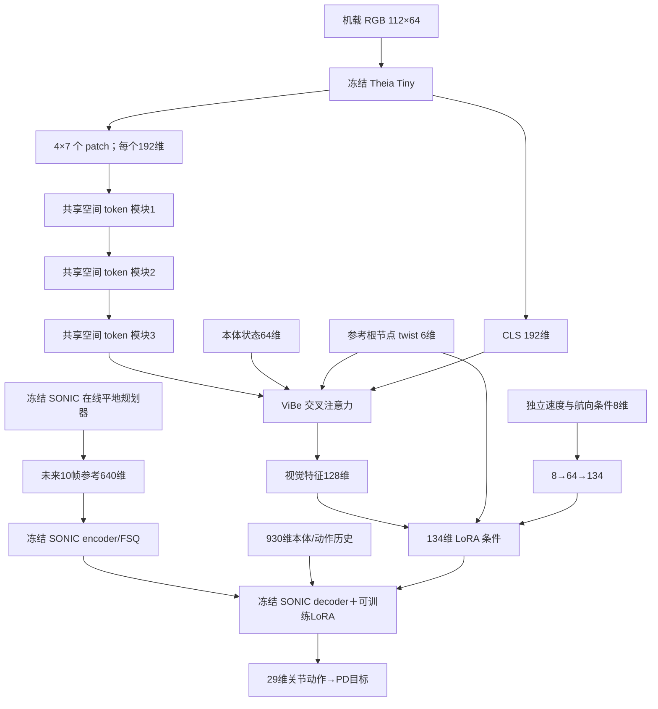

# ViBe + VGGT-Ω 蒸馏：上楼梯双实验

> **2026-10-27 已作废为正式训练方案。** 此处将用户的“楼梯实验”误解为只上行，并错误改动了原数据配比。两组单向上楼训练已停止；新主线恢复原 50/20/15/15 配比、上下楼/组合路线/平地与多速度任务。见 `vibe_vggt_stairs_retrain_20261027_zh.md`。本文保留作历史实现记录。

本文记录 2026-10-26 新增的实现。这里的性能收益是待验证假设；训练正常、蒸馏损失下降和录制成功，都不等于已经证明优于旧模型。容量与正式任务的最终运行信息见文末及 `records/vggt_distill_20261026/`。

## 1. 目标和实验边界

用冻结 VGGT-Ω 在训练时监督 ViBe 的共享视觉表征，取消旧的独立几何分支。部署时不需要 VGGT、几何真值、深度图或辅助预测头。两组使用完全相同的部署网络，改变几何蒸馏位置。

- **middle**：第二个空间 token 模块输出，对齐 VGGT-Ω aggregator 的最后一层，借鉴 Spatial Forcing 的中间层监督。
- **hierarchical**：第一、第二、第三个空间 token 模块输出，分别对齐教师零起始索引 11、17、23，借鉴 StageVLN 的多层监督。
- 每组正式使用 4 张 RTX 5090：middle 使用物理 GPU 0–3，hierarchical 使用 4–7。所有训练冒烟实验也至少使用两卡。
- PPO 任务只采样**前进上楼**，不采样下楼、上下楼或配对 GRAIL 楼梯动作。30% 平地 DAgger 环境只保留原 SONIC 动作能力。
- 没有语言模型、语言指令、导航离散动作或全局路径规划。最终控制输出仍然是 G1 的 29 维关节动作。

## 2. 论文依据与迁移方式

### StageVLN

本地 `StageVLN.pdf`，对应 <https://arxiv.org/abs/2610.05664>。其几何教师只看当前帧，学生导航模型看当前及历史图像；空间损失监督当前图像的中间视觉 token。教师特征按二维网格对齐，加入位置编码，再进行投影后的余弦对齐。还使用相对 heading 和专家路线进度辅助目标。教师及辅助头只用于训练。

本文迁移了多层特征监督、patch 位置对应、训练期辅助头以及动作输出之前的进度监督。没有照搬导航模型层号、语言输入或文本动作。我们的进度标签是实际机器人沿当前上楼场景的空间进度，不是论文中专家 forward 动作的累计比例。

### Spatial Forcing

本地 `SpatialForcing.pdf`，对应 <https://arxiv.org/abs/2510.12276>，项目页 <https://spatial-forcing.github.io/>。该文将 VLA 中间视觉 token 与 VGGT 几何特征对齐，使用归一化、两层投影 MLP、位置编码与余弦损失。其实验强调较深但非最末层的监督，并通过深度 probing 检查空间信息。

我们的 middle 实验在三层共享空间模块的第二层施加监督，后续层仍可服务动作任务。使用 LayerNorm 替代论文描述的 BatchNorm，适应小批次辅助训练。当前没有执行论文的深度 probing，因此不能把损失下降表述为已经证明完整三维重建能力。

### VGGT-Ω 教师

官方源码：<https://github.com/facebookresearch/vggt-omega>，固定到提交 `48b23c8ce72c9a8fcf987f0d7f43d8e4870759f6`，位于 `imports/vggt_omega_official`。论文：<https://arxiv.org/abs/2605.15195>。

使用用户已经下载的 `VGGT-Omega/VGGT-Omega/vggt_omega_1b_416_reproduce.pt`。选择 reproduction 权重与官方当前 benchmark 建议一致。权重 SHA256 写入两份实验 JSON；没有重新下载权重。只加载 aggregator，严格核对对应参数；不加载深度、相机或文本对齐预测头。

## 3. 推理架构



三个空间模块都在唯一的视觉控制路径中，没有独立 `hiking_latent` 输入、672 维几何条件、几何 LSTM 或三维解码器。

每个空间模块为 pre-LayerNorm、自注意力和 MLP 的残差块：宽度 192、3 个注意力头、MLP 隐层 384、GELU。注意力输入加入 0.1 倍二维 sine/cosine 位置编码。注意力输出投影和 MLP 最后一层零初始化，所以刚加入时三个模块是严格恒等映射。测试验证了它们在相同输入下保持旧 ViBe 抽取器输出不变。

新增模块需要留在部署中。训练期投影头能够删除，不代表新增空间模块没有推理开销。评估加载器会先验证删除全部辅助头前后的动作逐元素相同，再实际删除辅助头执行评估。

两组 SONIC、Theia、基础注意力参数和动作适配器都从相同来源初始化。三个新增空间模块的结构相同；仅训练期对齐头数量和损失接入点不同。辅助头在独立的 CPU 随机数上下文中初始化，避免单层/多层头的数量差异改变之后 Critic 的随机初始化。正式启动时，两个实验对应 rank 的共同 Actor 参数及 Critic 参数摘要逐一相同；rank 0 的摘要为 `1e7de540ae05ff040d1946a402f76dfcb6810875c529ce48f56917a78cdd0706`。组内还会广播、同步参数，并在保存时检查全部可训练参数一致。

### 输入分辨率的小调整

旧配置为 112×63，patch16 得到 3×7 个 token。本实验统一改为 **112×64**，得到 4×7 个完整 patch，避免底部不足一个 patch 的图像条带被丢弃。两组完全一致。这不是高分辨率视觉实验；与旧策略做严格消融时，应将相机尺寸变化单独控制。

当前模型没有视觉时序状态。SONIC 仍保留本体与历史动作，但它不等同于视觉记忆。若台阶离开视野后发生退化，需要另做加入共享视觉记忆的实验，不能认为单帧教师自动解决了遮挡记忆问题。

## 4. 教师特征提取与空间对齐

教师输入为同一物理时刻的 RGB，缩放到高 240、宽 416。学生看到的是上述低分辨率原图的 Theia 特征；放大给教师不会创造原图没有的细节。

张量形状是 `[B, 1, 3, 240, 416]`：B 表示不同环境，第二维 S=1 表示该环境的当前帧。**不能写成 `[1, B, ...]`**，否则不同物理世界会被教师当作同一场景的多视图。

教师输出层取 11、17、23，去掉 camera/register tokens。每层 patch 特征通道为 2048，恢复为 15×26 网格，再双线性对齐到学生 4×7 网格，保持行优先空间顺序。对每个 patch 的通道做 LayerNorm，加入 0.1 倍二维位置编码，然后做 L2 归一化。目标停止梯度并以 float16 缓存在 CPU；教师推理使用 bfloat16。

学生每个对齐头为 `LayerNorm(192) → Linear(512) → GELU → Linear(2048)`。空间损失：

\[
L_{spatial}=\frac{1}{|\mathcal P|}\sum_{(s,t)\in\mathcal P}
  \operatorname{mean}_{b,n}[1-\cos(P_s(H^s_{b,n}),\operatorname{sg}(G^t_{b,n}))].
\]

middle 的配对集合是学生第二层/教师第23层；hierarchical 是三组配对等权平均。两组都提取教师三层，使教师采样与计算预算一致。

## 5. 上楼辅助标签

辅助头接在真正供 LoRA 使用的 128 维视觉特征上；标签没有写入 actor 的观测字典。

### 脚—台阶关系

左右脚前缘中心依据实际脚姿态转换到当前台阶坐标。在脚前缘向前方向，寻找尚未越过超过 3 cm 的最近上升立面，得到：

1. 左右脚前缘到立面的水平距离，除以 1.5 m 并截断到 [-1,1]；
2. 对应台阶顶面相对脚前缘的高度，除以 0.35 m 并截断到 [-2,2]；
3. 左右脚实际支撑状态。

共六个目标。不存在下一立面时，距离和高度两类标签不参与损失；支撑标签仍有效。用 SmoothL1 的有效元素平均值训练关系预测头。这是当前几何关系监督，不是预测未来动作轨迹，也不构成显式落足规划。

### 空间进度

标签为 `clip((root_x - first_edge_x)/(goal_x-first_edge_x), 0, 1)`，只描述当前上楼路线的空间进度。进度头对 128 维视觉特征输出一个 logit，使用 soft-target BCE。没有向网络输入未来动作、未来帧或当前动作标签。

没有加入相对 heading 辅助损失：当前任务以 +X 前进为主，名义转向变化不足，直接照搬导航转角监督的价值有限。实际姿态和独立航向条件仍保留在原控制器中。

## 6. 训练目标与梯度

基础控制目标继承 PPO、系数 0.8 的平地 DAgger、上半身 SONIC 保持项及现有上楼接触质量奖励。

每四个 PPO minibatch 加一次辅助梯度：

\[
L_{aux}=0.3\,w(k)L_{spatial}+0.05L_{relation}+0.03L_{progress},
\quad w(k)=\min(1,(k+1)/200).
\]

辅助梯度与该 minibatch 的 PPO、DAgger 梯度在同一次 optimizer step 前累积，并一起执行跨 GPU 平均、梯度裁剪和优化。其余 minibatch 不额外计算辅助损失。因此这里的 0.3 不是“每个 PPO minibatch 都施加 0.3”。

- 可训练：共享空间块、ViBe 注意力、LoRA、独立速度分支、Critic，以及训练期辅助头。
- 冻结：SONIC encoder/FSQ/base decoder、Theia、VGGT-Ω、平地 SONIC DAgger 教师和在线 Planner。
- 蒸馏会改变共享视觉控制参数；第一次辅助反传使用 `autograd.grad` 检查其非零梯度。
- 不在冻结 Theia 特征后仅训练一个独立读出头；不使用经过 `detach()` 的诊断缓存作为学生表征。
- 教师目标不进入 PPO rollout 的 actor 输入，不增加部署特权信息。

当前没有更改旧的接触奖励公式。保留 Hiking 脚部体积边缘成本、脚撞立面、小腿撞击、摆脚净空、支撑边缘、滑动和硬着陆项。这使两组主要比较蒸馏位置；支撑腿接近立面的奖励覆盖缺口仍是未来需要单独验证的因素，不能声称本次已用奖励修复全部打脚问题。

## 7. 任务分配、数据来源与采样

每 20 个物理环境固定分配：14 个在线上楼 PPO、3 个在线平地 Planner DAgger、3 个原混合平地动作 DAgger。原来的 20% 配对楼梯 PPO 已取消。DAgger 环境由学生执行、原 SONIC 提供同状态标签；这些环境不进入 PPO 优势计算。

原完整四分片动作 bank 用于加载基础动作与平地来源，代码不会采样其中的配对楼梯动作。物理随机地形也把原下降槽位替换成上升副本；实际 PPO 只选择上升槽位，平地 Planner DAgger 选择平地槽位。运行时逐次更新审计实际任务分配。

上楼地形沿用 normal-stairs 难度结构：4–8 级、28–40 cm 踏面、2.5–25 cm 台阶高度、11 难度层与3种变体，初始开放低难度，随绝对训练更新数推进。随机化接近出生点、横向位置、参考相位和前进速度。PPO 排除零速流；平地 DAgger 保留零速能力。

每个 rank 每6个控制步随机选16个上楼环境，保存匹配的 RGB、冻结 Theia 特征及辅助标签。每个24步 rollout通常新增64张图像；首次可能额外包含初始化采样。更新开始时，教师以 batch4 生成标签，再从最近512个样本缓存中抽取 batch16 做辅助训练。缓存保存的是冻结特征及教师目标，不是随优化变化的学生中间特征。

## 8. 多卡、恢复与验证

两组是相互独立的四进程训练；组内梯度同步，组间不同步。rank 对应相同的动作分片与地形种子规则。正式参数、优化器、训练更新数、课程状态及每个 rank 的 DAgger/蒸馏缓存均可保存恢复。

checkpoint 原子写入。模型文件只在所有 rank 完成对应 sidecar 后写入。恢复保持相同组内 world size，物理环境和 Planner 以新 episode 开始；这不是逐物理子步的位级重放。允许显式改变环境数，但必须保留任务分配比例。

正式运行每卡 8000 个物理环境，每组 32000 个，其中 22400 个上楼 PPO、9600 个平地 DAgger；两组共 64000 个环境。每次 rollout 为24步。正式配置为15000次更新，每100次保存一次，启动后第一次更新也保存为 `model_0.pt`。因此 `model_1000.pt` 对应完成1001次更新，比较两组时使用相同文件编号即可。按目前约32–34秒一次更新估算，15000次需要数天；明天可以比较中间 checkpoint，不需要等待全部迭代结束。

正式任务已在后台启动，以下命令用于复现，不要在现有任务占用同组 GPU 时重复执行。从 `vibe_grail_joint/` 目录执行，给新实验选择新的日志目录：

```bash
.venv/bin/python -m vibe_grail_joint.vggt_distill.launch --gpus 0,1,2,3 train \
  --config configs/vggt_ascent_middle_20261026.json --log-dir runs/NEW_middle

.venv/bin/python -m vibe_grail_joint.vggt_distill.launch --gpus 4,5,6,7 train \
  --config configs/vggt_ascent_hierarchical_20261026.json --log-dir runs/NEW_hierarchical
```

恢复在相同命令后追加 `--resume runs/原运行/model_N.pt --iterations K`，其中 K 为追加更新数，并使用原运行的配置及完整 sidecar。启动清单 `records/vggt_distill_20261026/production_jobs.json` 保存正式任务的 PID、进程创建时间、GPU 和完整命令。每个正式运行目录内保存独立 `config.json`、262个源文件的 `source_snapshot/` 与 SHA256、TensorBoard events、每个 rank 的状态和逐更新指标。判断是否存活需同时检查真实进程和指标更新时间，不能只读历史 `status=running`。

验证包括：

- 新空间块零初始化时与旧抽取器输出逐元素相同；
- 辅助损失产生非零共享梯度，更新后确实改变控制视觉特征；
- 教师严格加载本地参数、冻结、输出有限且含空间变化；
- 改变批次中另一个环境的图像，不得改变本环境教师特征；
- 每次保存时核对各 rank 的全部可训练参数摘要一致；
- SONIC 冻结参数在保存及训练结束时摘要不变；
- 实际 PPO 地形全部为上升，且无配对环境；
- 评估时删除辅助头前后动作完全一致，不加载 VGGT。

## 9. 评估与录像

默认评估是120例：12/16/20/25/30 cm × 两种接近距离 × 0.25/0.4/0.7 m/s × 四个初始相位。30 cm 明确标记为超出在线训练高度上限。`--irregular` 改用独立随机种子的非等高、非等深上楼台阶。只包含上楼。

通过条件为根节点及双脚通过目标区域、保持直立支撑0.5秒且未跌倒。通过不等于无碰撞。报告保留所有请求案例，包括失败和超时，记录脚/小腿冲量与接触片段、速度误差、支撑滑动、边缘越界和上半身姿态。还提供 normal、zero_tokens、delay、freeze、swap_worlds 视觉干预；置零特征不等于黑色 RGB，均属于额外干预。

录像采用世界固定侧视相机，包含正常机载 RGB 小窗，检查相机漂移并记录帧数。录像选择由固定 case ID 确定，不按成功筛选。

运行入口均从 `vibe_grail_joint/` 目录执行，GPU 必须空闲；脚本不会停止其他任务：

```bash
# 相同更新数的两个 checkpoint 分别评估；示例路径中的 model_1000.pt 需实际存在。
bash scripts/evaluate_vggt_ascent.sh 0 configs/vggt_ascent_middle_20261026.json \
  runs/vggt_ascent_middle_20261026/model_1000.pt records/vggt_review_middle_1000

bash scripts/evaluate_vggt_ascent.sh 4 configs/vggt_ascent_hierarchical_20261026.json \
  runs/vggt_ascent_hierarchical_20261026/model_1000.pt records/vggt_review_hierarchical_1000

# 固定20cm、0.4m/s、phase0录像；可用额外参数覆盖高度/速度/接近距离。
bash scripts/record_vggt_ascent.sh 0 configs/vggt_ascent_middle_20261026.json \
  runs/vggt_ascent_middle_20261026/model_1000.pt records/vggt_video_middle_1000

.venv/bin/python -m vibe_grail_joint.vggt_distill.compare \
  --left records/vggt_review_middle_1000/report.json \
  --right records/vggt_review_hierarchical_1000/report.json \
  --output records/vggt_comparison_1000.json
```

比较程序检查案例、地形与初态一致，默认拒绝不同训练更新数。也可对 `evaluate` 使用 `--run-dir` 自动选择该运行最新完整 checkpoint，但正式对照应选择两组共同存在的更新数。

## 10. 文件入口

源代码：`src/vibe_grail_joint/vggt_distill/`。

| 文件 | 职责 |
|---|---|
| `model.py` | 三层共享空间块、ViBe 视觉路径、两种对齐位置、训练辅助头 |
| `teacher.py` | 本地 VGGT-Ω aggregator、当前帧批处理、位置对齐 |
| `collection.py` | 学生访问状态采样、仿真标签、CPU教师目标缓存 |
| `algorithm.py` | 与 PPO/DAgger 共同反传及优化 |
| `task.py` | 上楼专用 PPO 与平地保留任务 |
| `train.py` | 多卡训练、日志、checkpoint与恢复 |
| `audit.py` | 参数同步与实际任务分配审计 |
| `launch.py` | 物理GPU占用检查、文件锁与进程启动 |
| `scenes.py` | 独立评估上楼场景与固定案例 |
| `evaluate.py` | 评估、视觉干预、录像、辅助头移除验证 |
| `compare.py` | 相同案例/初态/预算对照 |
| `teacher_probe.py` | 本地教师输出与批次隔离检查 |

配置为 `configs/vggt_ascent_middle_20261026.json` 和 `configs/vggt_ascent_hierarchical_20261026.json`。有意义的单元检查位于 `tests/test_vggt_distill.py`。

## 11. 运行验证记录

验证目录为 `records/vggt_distill_20261026/`，机器可读汇总为 `validation.json`。下表中的显存为实际整卡使用量，包含仿真和图像渲染；不能仅用 PyTorch reserved memory 估计容量。

| 验证 | 实际结果 |
|---|---|
| 两卡 hierarchical，每卡400环境 | 3次完整更新正常结束，最高约14.40 GiB |
| 两组各四卡，每卡4000环境 | 各完成3次更新，最高约20.98 GiB |
| 四卡 middle，每卡6000环境 | 3次更新，最高约24.42 GiB |
| 两组各四卡，每卡8000环境 | 各完成3次更新，最高约28.04 GiB，无 OOM |
| 四卡 middle 恢复 | 从 `model_2.pt` 恢复全部优化器与各 rank 缓存，再训练2次，达到5次绝对更新；最高约28.03 GiB |
| 教师独立性 | 输出 `[2,3,28,2048]`，全部有限；改变另一个环境的图像，本环境特征变化为0；冻结检查通过 |
| CPU 单元检查 | `tests/test_vggt_distill.py`：6项通过 |
| 完整评估 | 两组各运行120例，全部案例及失败均写入报告；实际删除辅助头，未加载 VGGT |
| 录像 | 640×544、H.264、25 fps，实际逐帧解码75帧及111帧；固定相机最大位姿漂移为0 |

每卡6000/8000环境的多卡验证及正式启动，在保存时通过可训练参数同步检查；更早的小规模测试发生在该检查加入之前。所有正常结束的容量测试中，冻结 SONIC 参数摘要保持不变，三项辅助损失均有限，首次空间辅助反传对共享模块的梯度范数大于0。教师单图与批处理的 bfloat16 数值差异最大为0.0078125；真正的跨环境污染检查采用相同批次形状，扰动另一幅图像后差异为0。

两组正式任务于 **2026-10-26 17:23 UTC** 启动：

| 实验 | 物理 GPU | 每卡环境 | 正式目录 |
|---|---|---:|---|
| middle | 0、1、2、3 | 8000 | `runs/vggt_ascent_middle_20261026/` |
| hierarchical | 4、5、6、7 | 8000 | `runs/vggt_ascent_hierarchical_20261026/` |

正式启动检查确认八个 worker 存活，所有 rank 的损失有限，实际每卡任务分配为5600上楼 PPO、0配对、2400平地 DAgger。两组共同参数初态一致，每组的第一份模型与八份对应缓存文件均已保存。最终交接时的更新数、进程身份及显存快照见 `validation.json`，运行中的最新数值见各目录的 `rank_*_status.json`。

评估流程验证使用的是容量测试仅训练3次更新的 `model_2.pt`：middle 成功26/120，hierarchical 成功29/120。这些测试发生在正式训练的共同初始化核验之前，**只能证明评估流程可执行，不能用来选择优胜方案**。相同案例、地形、初态和迭代编号的比较检查已通过，结果保存在 `early_model2_pipeline_comparison.json`。正式研究结论需要使用上述两个正式运行的相同编号 checkpoint。

录像示例 `video_full_middle_model2/ascent_fixed_rgb.mp4` 是固定20cm案例，早期策略在4.44秒跌倒，失败轨迹完整保留。它用于验证录制与失败终止逻辑，不是成功展示。另有3秒/75帧的 `video_smoke01/ascent_fixed_rgb.mp4`。明天应同时比较成功率、脚/小腿碰撞、第一阶问题及视觉干预，不能仅看空间对齐损失或成功视频。
