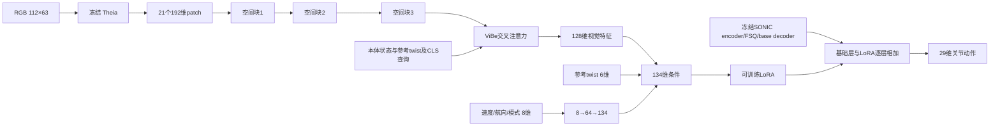

# ViBe + VGGT-Ω：恢复原数据配比的楼梯双实验

> **2026-10-27：本轮 112×63 训练已按用户要求停止。** 恢复原配置时错误回退了完整 patch 输入，导致底部 15 行未被编码及师生空间对应偏差。修复后使用 112×64 / 4×7、新目录和全新二阶段训练，见 [RGB64 修复后训练说明](vibe_vggt_stairs_rgb64_retrain_20261027_zh.md)。下文保留为历史配置记录。

本文件取代 `vibe_vggt_distillation_ascent_20261026_zh.md` 的正式训练方案。2026-10-26 那轮误把“楼梯实验”限制为单向上楼，并把原配比改成70/0/15/15，已停止且不再续训。旧权重、原始日志及录像保留为诊断材料。

本轮以 `current_hiking_gaussgym_vibe_architecture_20261024_zh.md` 和其引用的 `configs/hiking_gaussgym_rgb_20261023.json` 为任务依据：**恢复原来的地形、动作数据、任务分配、速度、课程和接触奖励，再研究 VGGT 蒸馏到 ViBe 的位置。** 不从上一轮错误配置的权重继续训练。

## 1. 数据来源与环境配比

| 环境组 | 比例 | 每卡6000时数量 | 用途 |
|---|---:|---:|---|
| 在线 Planner + 仿真随机地形 | 50% | 3000 | PPO：速度、上下楼及接触质量 |
| 原 GRAIL 动作 + 对应地形 | 20% | 1200 | PPO：原有配对动作跟踪 |
| 在线 Planner + 平地 | 15% | 900 | 学生执行，冻结 SONIC 提供 DAgger 标签 |
| 原混合平地动作 | 15% | 900 | DAgger：保留动作多样性 |

PPO 共4200环境/卡；DAgger 的1800环境不进入 PPO 优势估计。每组4卡共24000物理环境，两组共48000。这里6000指每卡环境数，原几何分支文档中的主线为单rank6000；本轮遵循用户要求，每个实验使用4卡。

完整数据 bank 为 `data/full_four_gpu_20261021` 的四个分片，两组分别使用全部四个分片。实际核对：

| 分片 | GRAIL/配对地形 | SONIC clips | 100style clips | LAFAN clips | real_pico clips |
|---|---:|---:|---:|---:|---:|
| rank 0 | 1450 | 28303 | 1740 | 222 | 24 |
| rank 1 | 1450 | 28304 | 1737 | 216 | 37 |
| rank 2 | 1450 | 28307 | 1747 | 233 | 20 |
| rank 3 | 1449 | 28294 | 1735 | 231 | 21 |

GRAIL 共5799条配对动作及地形。平地来源内部权重保持 LAFAN 0.3、100style 0.2、SONIC 0.4、real_pico 0.1；这些是平地来源权重，不是全部环境的比例，也不按上表 clip 数量直接决定采样概率。各分片的身份、frame数量及 bank.json SHA256 记录于 `records/vggt_stairs_retrain_20261027/data_audit.json`。

## 2. 仿真生成的规则和不规则楼梯

在线50%环境采用原 `normal_tiles` 和 `DaggerMotionCommand`，不修改其地形采样。

- 地形类型概率：上楼0.35、下楼0.25、上再下0.25、平地0.15，均指在线环境内部概率。
- 每个难度有3种变体：variant 0为等高、等深的规则楼梯；variant 1/2为高度、踏面变化的不规则楼梯。三种变体由原采样器等概率选择。
- 每段楼梯4–8阶，踏面28–40 cm；在线生成器的台阶高度截断在2.5–25 cm。
- 上下楼组合保留前方接近段、楼顶平台及离开段；独立下楼从高处平台初始化。
- 配对 GRAIL 场景另行保留，不能把在线生成器25 cm上限说成所有训练地形的统一上限。

课程保持11个难度层、每150次更新扩展一级。第900号checkpoint附近刚开放第7层，其名义最高阶高约18 cm（随机比例可到约18.9 cm）；此前主要覆盖更低的在线楼梯。最高层在约1350次更新开放，之后仍需训练。第900号在20/25/30 cm上的表现，不能替代完整课程训练后的结论。

## 3. 速度和参考

共享在线 Planner 流保留 `0、0.25、0.4、0.5、0.7 m/s`。在线初始化按原分布采样：零速6%，其余各23.5%；行走目标另加±0.04 m/s扰动。参考相位、出生位置和姿态随机化沿用原代码。平地 Planner DAgger 也保留不同速度；配对 GRAIL 与混合平地回放使用各自动作参考。

独立的8维速度/航向/任务模式输入保留，不能把 paired/online/flat 三个参考模式标记当成 PPO/DAgger 优化器分组。在线下楼仍向 +X 前进，不需要向后走。当前没有新增横移、转弯任务。

## 4. 共享视觉控制路径



本轮恢复原RGB分辨率112×63，因此学生patch网格为3×7。两组部署结构相同：3个192维、3头自注意力、MLP隐层384的共享残差块，再接原ViBe注意力。新增块的残差输出零初始化，初始为恒等映射。冻结 Theia 和 SONIC 基础网络，训练共享空间块、ViBe注意力、LoRA、独立速度分支及 Critic。

不保留原独立672维几何条件、LSTM及3D解码器。**这不表示VGGT蒸馏自动等价于原来的视觉记忆。** 当前路径仍是单帧视觉，SONIC的本体历史继续存在。与旧几何分支比较时，视觉记忆差异必须单独解释，不能将全部差异归因于蒸馏。

## 5. 两个蒸馏实验

| 实验 | GPU | 学生监督位置 | 教师层（零起始） |
|---|---|---|---|
| middle | 0–3 | 共享空间块2 | 23 |
| hierarchical | 4–7 | 共享空间块1/2/3 | 11/17/23 |

middle借鉴 Spatial Forcing 的中间表征监督，留出后续层服务动作；hierarchical借鉴 StageVLN 的多层对应监督。两者都是在小型ViBe视觉路径上的适配，不照搬原VLA/VLN语言模型的层号或动作空间。

教师使用本地 `vggt_omega_1b_416_reproduce.pt`，官方源码固定至 `48b23c8ce72c9a8fcf987f0d7f43d8e4870759f6`。只加载冻结 aggregator，以bfloat16推理。每个环境单独作为场景，输入 `[B,1,3,240,416]`，不会把不同环境当同一场景的多视图。

取教师11/17/23层，去除特殊token，将15×26网格对齐到学生3×7网格，进行通道LayerNorm、二维位置编码及L2归一化。每层目标维度2048。学生投影头为 `LayerNorm(192)→512→GELU→2048`，使用patch余弦损失。教师和全部辅助头仅用于训练；部署保留共享空间块。

辅助头初始化使用独立CPU随机数上下文，避免不同头数量改变共同Actor/Critic的初始化。两组必须从同一一阶段checkpoint启动，核验对应rank共同参数摘要一致。

## 6. 几何关系与进度辅助监督

采集对象保持为学生实际访问的在线PPO环境，与旧几何监督的在线采样范围一致；配对GRAIL仍通过PPO参与动作训练。

每6步选16个在线环境，缓存同一时刻RGB、冻结Theia特征及标签；24步rollout通常新增64张，CPU近期缓存512张。教师batch4，辅助batch16，每4个PPO minibatch计算一次辅助梯度。

关系标签为左右脚前缘到下一台阶边缘的水平距离、目标台阶顶面相对脚前缘高度，以及左右脚支撑状态。新配置明确使用 `ascending_and_descending`，搜索正负高度跳变，下降台阶的相对高度可以为负；不会把下降边缘全部屏蔽掉。平地没有边缘时屏蔽距离/高度监督，支撑监督仍有效。进度为当前路线空间位置比例。

\[
L_{aux}=0.3\min(1,(k+1)/200)L_{spatial}+0.05L_{relation}+0.03L_{progress}.
\]

辅助梯度与PPO、系数0.8的DAgger和上半身保持项在同一optimizer step前累积，执行相同DDP平均和梯度裁剪。标签及教师输出不进入actor部署观测。原有Hiking、脚/小腿碰撞、滑动、净空、支撑边缘、上半身姿态等奖励保持原公式与权重。

## 7. 重新训练与审计

初始化沿用架构文档的一阶段权重 `runs/20261016_vibe_rgb_stairs_only/model_14999.pt`，不是旧单向上楼蒸馏checkpoint，也不是把旧几何策略删掉分支后直接继续训练。Critic、optimizer和蒸馏辅助头重新初始化。

代码在每次更新检查实际50/20/15/15数量、PPO包含配对环境、四种在线地形均出现、五档参考速度均出现、配对clip确实来自GRAIL且具有对应terrain_id、Planner DAgger位于平地，以及四种平地来源的权重。每次保存检查跨rank可训练参数摘要；完成容量测试时检查冻结SONIC摘要未变。

每卡8000环境的测试在初始化参数同步时出现CUDA显存不足，堆栈定位到上游PPO的 `broadcast_object_list`：它将rank 0的CUDA张量反序列化到其他进程的cuda:0，产生额外上下文和临时模型副本。蒸馏PPO已改为对当前rank设备上的参数和持久buffer逐张量原地广播；不修改模型、损失或梯度平均方法。此前每卡6000的两组四卡完整任务均完成3次更新，冻结SONIC/DAgger教师和跨rank参数检查通过，最高观测整卡占用29.94 GiB。修复后的同步另行验证；不把8000的初始化失败当作完整rollout的容量结论。正式配置采用每卡6000并保留显存余量。测试与正式任务路径和验证结果记录于 `records/vggt_stairs_retrain_20261027/`，最终运行信息在完成检查后追加。

已知物理限制：恢复的GRAIL高度场在个别状态触发MuJoCo Warp的 `height field collision overflow`。当前引擎每个高度场碰撞对最多暂存50个候选接触，达到上限后跳过后续候选；这不是NaN或训练退出，但可能影响相关状态的接触求解。2026-10-21原Hiking/SSR基线日志已有同类警告。本轮不通过删除配对地形或降低高度场分辨率来掩盖它，也不据此声称接触仿真已经完全验证。日志保留并统计警告次数；后续若改碰撞实现，应作为对两组共同实施的独立修复验证。

两组计划15000次更新、每100次保存。新配置：`configs/vggt_stairs_middle_20261027.json` 与 `configs/vggt_stairs_hierarchical_20261027.json`。原配置与新配置的逐字段差异保存在 `config_diff_*.json`，主要任务与奖励字段保持一致；允许的区别包括去掉独立几何训练、增加蒸馏、四卡资源设置、checkpoint间隔和记录字段。

## 8. 录像与评估口径

录像支持 `--route up/down/up_down`，其中up_down为平地→上楼→平台→下楼→平地。固定场景可选20/25/30 cm和不同速度。新训练的评估需使用本轮配置与本轮checkpoint；旧54段 `model_900.pt` 录像仅用于诊断旧配置，不能当作新训练结果。

此前高速录像发现原判定要求双脚踝连续0.5秒同时接近地面，可能将已经通过楼梯的高速行走误记为未完成。录像的walking口径改为：根节点及双脚越过目标区域、实际至少一只脚支撑、身体直立、根节点净空足够，连续保持0.5秒。原固定基准默认strict口径保留，报告显式记录 `completion_mode`。本轮未悄悄修改训练成功奖励/终止条件；后续分析要区分这两种统计口径。

```bash
# 从 vibe_grail_joint/ 执行；GPU必须空闲，输出目录必须是新目录。
bash scripts/record_vggt_ascent.sh 0 \
  configs/vggt_stairs_middle_20261027.json \
  runs/vggt_stairs_middle_20261027/model_1000.pt \
  records/NEW_stairs_video \
  --route up_down --heights .25 --speeds .7 --duration 60
```

脚本名保留历史兼容；实际路线以 `--route`、画面和report为准。失败、碰撞和超时均保留，不按成功挑选视频。对照应选择相同更新数、初态、地形、速度与通过口径，并同时比较速度误差和接触质量。

`vggt_distill.compare` 现支持三种路线；左右报告的路线、初态、地形及通过口径必须一致。walking与strict报告不允许直接比较。统计保留失败案例的碰撞和速度误差，避免只统计通过案例。

## 9. 2026-10-27 实测与正式启动

正式任务于UTC 03:09启动，运行目录为：

- middle：`runs/vggt_stairs_middle_20261027/`，GPU 0–3。
- hierarchical：`runs/vggt_stairs_hierarchical_20261027/`，GPU 4–7。

每组4卡、每卡6000环境，总计48000环境。两组均从原一阶段权重重新开始，不恢复旧单向任务，也不继承容量短测的optimizer或训练进度。每100次更新保存，计划15000次更新。启动清单、PID、完整命令和日志在 `records/vggt_stairs_retrain_20261027/production_jobs.json`；每个run保留启动配置及313个源码/脚本/测试文件的快照与SHA256。

同步修复后的两组四卡短测均完成3次更新、checkpoint及全部rank缓存保存，最大观测整卡占用28.225 GiB。冻结网络未变，跨rank可训练参数完全一致；两组对应rank的共同Actor/Critic初始化摘要一致。蒸馏损失对共享动作路径的空间块确有非零梯度（首次审计范数middle 0.5734、hierarchical 0.3367）。

以短测rank 0的实际采样为例：在线3000、GRAIL配对1200、Planner平地900、回放平地900；在线地形上楼1042、下楼779、组合755、平地424。在2576个在线楼梯环境中，规则variant 0占849个，不规则variant 1/2分别占882/845个。下楼四档行走速度0.25/0.4/0.5/0.7分别采到173/209/162/194个环境；不是只在上楼环境加入高速命令。

8项功能测试通过。两种短测checkpoint分别在20 cm、0.4 m/s的上楼/下楼/组合路线重载运行，确认不需要VGGT教师、删除辅助头不改变动作、两组初态和物理地形匹配。**这是短测checkpoint的运行检查，不是学成后的性能报告；有跌倒案例且全部保留。** 对照工具在这三类真实报告上完成匹配检查，并拒绝混用通过口径。该工具及其测试在正式启动后更新，另存 `evaluation_source_snapshot/`，训练代码未改变。

全部机器可读验证结果见 `records/vggt_stairs_retrain_20261027/validation.json`，软件版本见同目录 `package_versions.json`。旧轮54段录像的逐段文件、预览页和压缩包均保留在 `records/vggt_video_review_20261027/`。

正式运行健康检查（UTC 2026-10-27T03:15:15.018929+00:00）：
- middle：4个训练worker均存活，各rank已完成更新数 [10, 10, 10, 10]；最大观测整卡占用 28.200 GiB；首个checkpoint及8个rank缓存侧文件完整，损失有限，任务/速度/规则楼梯审计通过。高度场警告行数为 0（行数不等于受影响环境数）。
- hierarchical：4个训练worker均存活，各rank已完成更新数 [10, 10, 10, 10]；最大观测整卡占用 28.256 GiB；首个checkpoint及8个rank缓存侧文件完整，损失有限，任务/速度/规则楼梯审计通过。高度场警告行数为 110（行数不等于受影响环境数）。

两组共同初始化摘要一致；正式训练源码与启动快照一致，启动后仅补全评估对照工具及其测试。该检查是启动健康检查，不是最终训练性能验收；实时进度以各run的 `rank_*_status.json` 为准。
